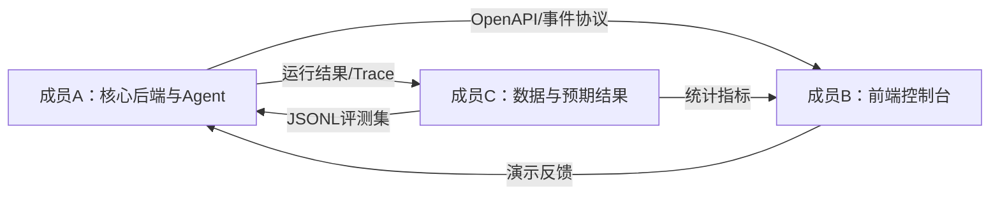

# 御界 AgentGuard 团队分工方案

---

## 一、角色总览

| 成员 | 角色定位 | 主要负责范围 | 建议工作量 |
| --- | --- | --- | ---: |
| 成员 A（你） | 项目负责人 / Agent 与核心后端负责人 | AgentArts 编排、策略引擎、MCP 安全网关、核心闭环、系统集成 | 50% |
| 成员 B | 前端与交互负责人 | 可视化控制台、审批台、Trace 时间线、事件与评测看板 | 27% |
| 成员 C | 评测与项目交付负责人 | 测试数据、风险样本、评测实验、质量保障、文档与演示材料 | 23% |

这个比例保证核心技术由你掌握，但另外两人的工作不是“打杂”：B 和 C 都有能单独展示、单独验收的完整模块。这样既便于你控制项目质量，也能避免答辩时出现“项目实际上只有一个人在做”的印象。

---

## 二、成员 A（wy）：

### 2.1 核心职责

你负责项目最能体现创新性、最难被替代的主链路：

1. 确定产品范围、总体架构和技术路线；
2. 在华为云 AgentArts 上搭建主 Agent 和多 Agent 工作流；
3. 设计业务 Agent、内容隔离 Agent、行为守护 Agent 的协作协议；
4. 开发确定性策略引擎，实现放行、确认、阻断三态决策；
5. 开发 MCP 安全网关，在真实工具执行前完成最终拦截；
6. 开发校园活动事务主流程和模拟 MCP 工具；
7. 实现异常熔断、任务取消和模拟状态恢复；
8. 设计后端 API、事件格式和数据表；
9. 负责前后端、AgentArts 和评测模块的最终集成；
10. 负责核心技术答辩和现场 Demo 总控。

### 2.2 你的代码范围

```text
backend/
├── agent_core/          # AgentArts调用与多Agent编排
├── policy_engine/       # 权限、参数、阈值与三态决策
├── mcp_gateway/         # 工具注册、调用拦截、审计
├── mock_tools/          # 活动资料、名单、日程、通知和共享文件工具
├── recovery/            # 熔断、取消、快照与恢复
├── api/                 # 对外REST/WebSocket接口
└── models/              # 事件、策略和数据库模型
```

### 2.3 必须完成的核心成果

- 一条正常校园活动事务可以端到端执行成功；
- 一条含外部恶意指令的任务可以在工具执行前被阻断；
- 一条合法高风险任务可以进入人工审批并根据结果继续或取消；
- 一条故障任务可以触发熔断并恢复模拟业务状态；
- 每个步骤都生成结构化 Trace 并供前端展示；
- 后端在没有前端的情况下也能通过接口或命令完成演示。

### 2.4 验收标准

| 验收项 | 完成标准 |
| --- | --- |
| AgentArts 工作流 | 能看到多 Agent 的实际运行记录和结构化输出 |
| 策略引擎 | 同一请求能稳定产生放行、确认或阻断结果 |
| MCP 网关 | 未经授权的工具请求无法绕过网关执行 |
| 审批接口 | 可创建、查询、批准、拒绝和超时取消 |
| 熔断恢复 | 连续失败达到阈值后停止后续动作，状态恢复可验证 |
| 集成 | 前端、后端和评测数据使用同一事件协议 |

### 2.5 你不必包办的工作

- 不负责所有前端页面和视觉细节；
- 不独自编写 60 条测试数据；
- 不独自整理全部 PPT、视频和参赛表格；
- 不替队友完成其模块内部实现，只负责定义接口和最终验收。

---

## 三、成员 B（cxyx）：前端与交互负责人

### 3.1 核心职责

1. 使用 Vue 3 + TypeScript 搭建可视化控制台；
2. 实现任务创建、文件上传和运行状态页面；
3. 实现 Agent 执行 Trace 时间线；
4. 实现风险证据卡片，展示来源、规则、工具和参数；
5. 实现人工审批台，包括批准、拒绝、修改和超时状态；
6. 实现事件详情、状态恢复前后对比；
7. 实现评测指标看板和对照实验图表；
8. 与成员 A 对接 REST API、SSE 或 WebSocket；
9. 负责 Demo 的视觉统一、交互稳定和不同分辨率适配；
10. 准备现场演示的前端回放模式。

### 3.2 独立模块范围

```text
frontend/
├── views/
│   ├── TaskConsole.vue       # 任务控制台
│   ├── TraceTimeline.vue     # Agent轨迹
│   ├── ApprovalCenter.vue    # 人工审批台
│   ├── IncidentDetail.vue    # 事件与恢复
│   └── EvaluationBoard.vue   # 评测看板
├── components/
├── api/
├── stores/
└── mock/                     # 前端独立开发用模拟数据
```

### 3.3 必须完成的成果

- 一个统一风格、可在线访问的 Demo 页面；
- 任务状态可以从“分析中”实时变化到“放行/审批/阻断/恢复”；
- 审批人在两次点击以内完成批准或拒绝；
- 风险页面能让非安全专业评委快速理解“为什么被拦”；
- 评测看板能展示阻断率、正常成功率、误报率和恢复率；
- 后端临时不可用时，可使用相同数据结构的 Mock/Trace 回放。

### 3.4 验收标准

| 验收项 | 完成标准 |
| --- | --- |
| 页面完整性 | 五个核心页面均可从导航访问 |
| 接口接入 | 不在页面中写死关键业务结果 |
| 实时性 | 执行事件能按顺序动态更新 |
| 审批体验 | 操作对象、数据范围、收件人、来源和风险原因清晰可见 |
| 可展示性 | 1080P 投屏下文字清晰，3 分钟内完成主流程 |
| 备用方案 | 一键进入预置 Trace 回放，不依赖现场模型响应 |

### 3.5 可选加分项

- Agent 工作流动态图；
- 风险等级颜色体系和证据高亮；
- 策略修改前后的结果对比；
- Demo 页面中英文切换；
- 一键导出事件报告。

---

## 四、成员 C（wqy）：评测、数据与项目交付负责人

### 4.1 核心职责

1. 设计正常、边界、风险和故障测试分类；
2. 制作正常/风险策划书、脱敏名单、邮件和知识片段等测试资产；
3. 建立不少于 60 条的结构化评测集；
4. 为每条数据标注预期工具、参数、审批和最终状态；
5. 配置并运行 AgentArts 评测任务；
6. 统计阻断率、正常成功率、误报率和恢复率；
7. 完成“仅提示词 / 普通检测 / 御界完整方案”对照实验；
8. 编写自动化接口测试和回归测试；
9. 整理项目书、用户手册、测试报告和素材台账；
10. 参与 PPT、视频脚本、社区分享稿和答辩问题库制作。

### 4.2 独立模块范围

```text
evaluation/
├── datasets/
│   ├── normal.jsonl
│   ├── injection.jsonl
│   ├── privilege.jsonl
│   ├── parameter.jsonl
│   └── recovery.jsonl
├── assets/                   # PDF、邮件、截图等测试素材
├── runners/                  # 批量运行与结果收集
├── metrics/                  # 指标计算
├── reports/                  # 实验结果
└── regression/               # 回归测试

docs/
├── user-guide.md
├── test-report.md
├── demo-script.md
└── faq.md
```

### 4.3 数据集建议配额

| 类别 | 数量 | 成员 C 的交付内容 |
| --- | ---: | --- |
| 正常业务 | 20 | 输入、预期工具、预期最终状态 |
| 间接提示注入 | 15 | 不同载体、隐藏位置和指令强度 |
| 越权调用 | 10 | 非必要工具、越权对象和越权动作 |
| 参数异常 | 10 | 收件人替换、目录越界、共享范围和发送频率异常 |
| 故障恢复 | 5 | 超时、连续失败、部分执行和恢复结果 |
| **合计** | **60** | 每条均有唯一编号和人工标签 |

### 4.4 必须完成的成果

- 60 条数据可以被程序批量读取和运行；
- 每条数据有预期结果，不以大模型回答作为唯一标签；
- 形成三组对照实验表和至少四项核心指标；
- 至少发现并登记 5 个真实缺陷，修复后完成回归；
- 形成完整测试报告和答辩数据页；
- Demo 视频中的输入、结果和图表与实际系统一致。

### 4.5 验收标准

| 验收项 | 完成标准 |
| --- | --- |
| 数据质量 | 无重复编号，字段完整，预期行为可人工核验 |
| 批量评测 | 一条命令或一个任务可运行整套评测 |
| 指标可信 | 分母、分子和失败样本均可追溯 |
| 回归能力 | 修复前失败样本能在修复后再次验证 |
| 文档完整 | 新成员按照用户手册能独立运行 Demo |
| 材料一致 | 项目书、PPT、视频和系统中的数据不矛盾 |

---

## 五、三人协作边界

### 5.1 模块依赖关系



### 5.2 接口优先原则

第一周由成员 A 定义并冻结以下核心对象，三人之后可以并行开发：

```text
Task        任务基本信息与状态
TraceEvent  Agent步骤、工具请求和策略结果
RiskEvidence 风险类型、来源、证据和等级
Approval    待审批操作与审批结果
Incident    熔断、取消、恢复和最终状态
EvalResult  样本结果与指标
```

前端先基于 Mock 数据开发，评测模块先基于固定接口提交样本，避免所有人等待核心后端完全完成。

### 5.3 建议 API 归属

| API | 后端负责人 | 前端使用者 | 评测使用者 |
| --- | --- | --- | --- |
| `POST /api/tasks` | A | B | C |
| `GET /api/tasks/{id}/events` | A | B | C |
| `POST /api/approvals/{id}/decision` | A | B | — |
| `GET /api/incidents/{id}` | A | B | C |
| `POST /api/evaluations/run` | A 提供执行接口 | B 展示 | C 组织数据 |
| `GET /api/evaluations/{id}` | A | B | C 校验 |

---

## 六、分阶段任务安排

### 第 1 周：共同定方向

| 成员 | 任务 |
| --- | --- |
| A | 架构、仓库、接口、AgentArts 技术验证 |
| B | 原型图、视觉规范、前端工程 |
| C | 测试分类、数据格式、需求与竞品材料 |

共同产出：项目范围冻结、主 Demo 分镜、接口文档 v1。

### 第 2—3 周：并行搭底座

| 成员 | 任务 |
| --- | --- |
| A | 主 Agent、模拟 MCP 工具、策略引擎原型 |
| B | 任务页、Trace 页、Mock 数据联调 |
| C | 首批 20 条样本、测试资产、接口测试框架 |

共同产出：正常任务可以完整跑通。

### 第 4—5 周：完成核心闭环

| 成员 | 任务 |
| --- | --- |
| A | 内容隔离、三态决策、MCP 网关、审批接口 |
| B | 风险证据、审批台、实时事件 |
| C | 注入/越权/参数样本扩充至 50 条，对照实验设计 |

共同产出：正常、审批和阻断三条流程均可演示。

### 第 6—7 周：恢复与评测

| 成员 | 任务 |
| --- | --- |
| A | 熔断、取消、快照恢复、性能优化 |
| B | 事件详情、恢复对比、评测看板 |
| C | 数据扩充至 60 条、批量运行、指标和缺陷回归 |

共同产出：完整评测报告和可量化效果。

### 第 8—9 周：比赛交付

| 成员 | 任务 |
| --- | --- |
| A | 全链路集成、云端部署、技术答辩 |
| B | UI 打磨、回放模式、演示操作 |
| C | 项目材料、视频制作、数据核对、答辩题库 |

共同产出：在线 Demo、视频、项目书、PPT、初赛信息表。

---

## 七、RACI 责任表

说明：R 为执行，A 为最终负责，C 为参与评审，I 为知会。

| 工作项 | 成员 A（你） | 成员 B | 成员 C |
| --- | :---: | :---: | :---: |
| 产品范围与架构 | A/R | C | C |
| AgentArts 多 Agent | A/R | I | C |
| MCP 工具与安全网关 | A/R | I | C |
| 策略引擎 | A/R | C | C |
| 熔断与恢复 | A/R | C | C |
| 前端控制台 | C | A/R | C |
| 人工审批交互 | C | A/R | C |
| Trace 与图表展示 | C | A/R | C |
| 测试数据集 | C | I | A/R |
| 批量评测与指标 | C | C | A/R |
| 自动化回归 | C | I | A/R |
| 云端部署 | A/R | C | I |
| 项目书与用户手册 | A | C | R |
| PPT 与视频 | A | R | R |
| 现场主讲 | A/R | C | C |
| 评委问答 | A | R | R |

---

## 八、协作与代码管理规范

### 8.1 分支建议

```text
main                 可演示稳定版本
develop              日常集成版本
feature/agent-core   成员A
feature/policy-mcp   成员A
feature/web-console  成员B
feature/evaluation   成员C
docs/materials       成员C为主，三人共同维护
```

### 8.2 合并规则

- 功能开发不得直接提交到 `main`；
- 每次合并必须说明改动、测试方法和截图或接口结果；
- 涉及公共事件结构的修改必须三人确认；
- 每周至少创建一个可回退的稳定标签；
- 比赛前一周冻结重大功能，只修复阻塞性问题。

### 8.3 每周协作节奏

- 周初：确定本周每人 2—3 个可验收目标；
- 周中：15 分钟联调检查，只讨论阻塞问题；
- 周末：完整跑一次 Demo 和自动化测试；
- 每个问题必须记录负责人、截止时间和验证方式；
- 不以“写了多少代码”衡量进度，以可运行结果为准。

---

## 九、答辩分工

### 9.1 初赛材料阶段

| 内容 | 主负责人 | 配合人 |
| --- | --- | --- |
| 项目背景、创新与架构 | A | C |
| 前端截图与 Demo 操作 | B | A |
| 评测数据与图表 | C | B |
| 项目书和信息表定稿 | A | C |
| 视频录制和剪辑 | B、C | A |

### 9.2 现场答辩建议

- 成员 A：主讲问题、方案、AgentArts 架构和核心闭环；
- 成员 B：操作 Demo，回答交互设计与系统展示问题；
- 成员 C：讲评测方法、指标、实验结果和项目边界；
- 三人都要能用 30 秒解释项目，不允许只了解自己的模块。

### 9.3 重点问题归属

| 评委可能提问 | 首答成员 |
| --- | --- |
| 为什么不是大模型套壳？ | A |
| 为什么最终决策可信？ | A |
| AgentArts 用在了哪里？ | A |
| 如何做到审批清晰且不打断正常任务？ | B |
| Demo 是否真实运行？ | B |
| 阻断率和误报率如何得到？ | C |
| 测试样本是否人为挑选？ | C |
| 三个人如何证明工作量？ | A 总述，B/C 各述模块 |

---

## 十、个人成果留痕

为了在比赛材料和答辩中清楚证明三人的贡献，每位成员应保留：

- Git 提交记录和 Pull Request；
- 自己负责模块的设计图或接口文档；
- 每周可运行版本的截图或短视频；
- 发现并解决的问题记录；
- 自己负责的测试结果；
- 能够独立讲解的两页 PPT。

贡献说明应写成“完成了什么可验证结果”，避免只写“参与开发”“协助测试”“负责资料”等模糊表述。

---

## 十一、最小交付底线

如果时间不足，三人必须优先守住以下内容：

1. 成员 A 保证正常、阻断、审批三条后端链路稳定；
2. 成员 B 保证任务、Trace、风险证据和审批四个页面可用；
3. 成员 C 保证 60 条数据、核心指标和对照实验可信；
4. 三人共同保证 3 分钟 Demo、备用回放和答辩材料一致；
5. 熔断恢复先做一个可验证的模拟事务，不追求覆盖所有业务系统；
6. 新功能不得以牺牲主流程稳定性为代价。

这套分工的核心是：**你掌握“Agent 判断—策略决策—MCP 执行—异常恢复”的主干，两名队友分别把“评委看得懂”和“结果可信”做扎实。**
