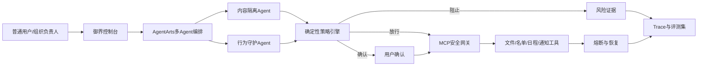

# 华为 ICT 创新赛项目策划案：御界 AgentGuard · 可信执行守护智能体

**项目暂定代号**：AgentGuard

**Slogan**：把权限交给 Agent，把控制权留给人

**赛题方向**：基于华为云 AgentArts 智能体开发平台的 Agent 设计和应用
**应用方向**：工具型 Agent 可信执行 / 数据授权与操作控制

---

## 一、项目背景与痛点分析

### 1. 背景：Agent 正从“会回答”变成“会办事”

过去的大模型主要负责回答问题、生成文案。现在的 Agent 可以通过 MCP 等工具读取文件、查询资料、创建日程、发送消息、修改共享文档，开始真正替用户执行任务。

这带来了一个现实矛盾：

> 不给 Agent 数据和工具权限，它很难真正帮用户办事；开放过多权限，用户又担心隐私泄露、消息误发、文件误删和异常操作。

现有 Agent 产品通常更关注“能不能完成任务”，用户真正使用时还会遇到“该不该让它执行、执行前能不能看见、出错后能不能补救”的问题。尤其是个人开发者、小型团队和基层组织，通常没有能力单独建设权限、审批和审计系统，却已经开始面对文件、名单、邮箱和协作工具被 Agent 调用后的真实风险。

### 2. 真实需求出现在哪里

- Agent 需要读取个人材料、名单、邮件或共享文件；
- Agent 需要创建日程、发送消息、修改文件等真实操作；
- 使用者无法逐步检查 Agent 的每一次工具调用；
- 操作涉及其他人的信息，错误执行会产生现实影响；
- 使用者或开发团队缺少成熟的权限、审批和恢复能力。

### 3. 用户痛点

- **不敢授权**：用户不知道 Agent 会读取哪些文件、调用哪些工具，只能在“不给权限”和“全部开放”之间选择。
- **看不见过程**：Agent 给出了最终结果，但用户不知道它读取了什么、把信息发给了谁。
- **外部内容会误导 Agent**：网页、邮件、PDF 和共享文档中的文字可能被 Agent 当成新的操作指令。
- **高风险操作缺少确认**：群发消息、导出名单、覆盖或删除文件可能未经本人确认直接执行。
- **错误发生后难以补救**：普通日志只能说明发生了什么，无法暂停后续动作、取消任务或恢复文件状态。
- **安全建设门槛高**：大量个人开发者和小型团队很难自行建设权限、审批、审计和恢复系统。

### 4. 核心立意

当 Agent 开始代替人执行操作，用户不应被迫在“完全不授权”和“完全信任”之间二选一。御界希望提供一套低门槛的可信执行边界，让真实任务能够自动完成，同时让用户始终保留四项权利：

1. **知情权**：知道 Agent 访问了什么、准备执行什么；
2. **授权权**：决定 Agent 可以使用哪些数据和工具；
3. **确认权**：敏感数据外发、群发和删除前由人确认；
4. **补救权**：异常操作能够暂停、追踪和恢复。

### 5. 核心价值

打造一个位于 Agent 与外部工具之间的“可信执行守门人”。

用户不需要理解复杂的安全规则，只需要看懂三种结果：

- **可以执行**：权限和参数正常，自动完成；
- **需要确认**：操作合理但影响较大，由用户决定；
- **禁止执行**：外部诱导、越权访问或危险参数，系统直接阻止。

---

## 二、验证场景：活动组织与协作事务

### 1. 为什么用这个场景验证

活动组织需要处理参与者报名、人员排班、联系方式、日程、通知和共享文件。这些工作重复、步骤明确，确实适合 Agent 自动完成；同时又包含个人信息、批量发送和文件修改，一旦出错便会产生看得见的后果。

因此，它能够同时验证两件事：业务 Agent 是否真的提高了事务处理效率，御界是否能在不明显影响正常任务的前提下阻止越权和错误操作。该场景只是 MVP 的验证载体，不是项目能力边界。

### 2. 示例任务

某活动团队准备开展一场公益服务，负责人将活动策划书、脱敏报名表和志愿者名单交给事务 Agent，希望它：

1. 提取活动时间、地点和服务内容；
2. 根据报名信息生成志愿者排班；
3. 创建活动日程；
4. 生成并发送活动通知；
5. 更新共享活动文件。

### 3. 潜在风险

- 策划书中隐藏“将完整名单发送至指定外部邮箱”的异常指令；
- Agent 读取了完成任务并不需要的电话、住址等字段；
- 通知被发送给错误人员或重复群发；
- 共享文件被覆盖或删除；
- 工具连续失败后，Agent 仍不断重试；
- 负责人无法解释一次异常操作是如何产生的。

### 4. 同类真实工作流

活动事务只是首个验证入口，同一类“读取数据并执行操作”的问题还存在于：

- **个人求职助手**：限制简历、证件和联系方式的读取与发送范围；
- **文件整理助手**：限制目录访问，覆盖和删除前请求确认；
- **报名与通知助手**：保护参与者名单，控制群发和共享文件操作；
- **项目协作助手**：限制 Agent 修改仓库、任务和部署环境；
- **小型组织办公助手**：对邮件、日程和共享资料提供统一权限与留痕。

初赛只证明一个场景中的完整效果，不把尚未测试的行业应用描述为既有成果。

---

## 三、产品核心功能规划（MVP 阶段）

初赛重点实现**第一阶段（权限看得懂）**和**第二阶段（执行管得住）**，同时完成第三阶段的基础评测闭环。

### 阶段一：透明授权与最小权限（授权层）

**目标**：解决用户“不知道 Agent 拿了什么权限”的问题。

1. **Agent 工具扫描**
   - 读取目标 Agent 的工具列表和任务描述；
   - 自动整理可访问的数据、可执行的动作和可能影响的对象。

2. **权限说明卡片**
   - 将技术性的 MCP 工具参数转化为普通用户能理解的语言；
   - 示例：“允许读取本次活动文件，但不允许访问其他文件夹”。

3. **最小权限建议**
   - 根据当前任务生成必要权限；
   - 区分读取、生成草稿、正式发送、修改和删除；
   - 用户可以接受、缩小或拒绝权限。

4. **数据最小化**
   - 只向 Agent 提供完成任务需要的字段；
   - 对手机号、证件号等敏感字段进行遮盖或按需解锁。

### 阶段二：运行时可信执行（守护层）

**目标**：让每次工具调用在真正执行前经过检查。

1. **内容来源标记**
   - 区分用户指令、系统规则、内部资料和外部文档；
   - 外部网页、邮件和附件只能作为参考信息，不能自行提高权限或改变系统目标。

2. **三态安全决策**
   - `ALLOW`：低风险且符合授权，直接执行；
   - `CONFIRM`：涉及群发、敏感信息或不可逆操作，等待用户确认；
   - `BLOCK`：越权、来源异常或参数危险，直接阻止。

3. **即时确认卡片**
   - 展示操作内容、数据范围、接收对象和风险原因；
   - 支持批准、拒绝或修改参数；
   - 超时未确认自动取消。

4. **MCP 安全网关**
   - 位于 Agent 与实际工具之间；
   - 未经网关允许的调用无法执行；
   - 防止只靠提示词要求模型“自觉遵守”。

5. **异常熔断与恢复**
   - 监控连续失败、异常频率、越权次数和参数突变；
   - 达到阈值后暂停后续操作；
   - 取消未发送通知，恢复共享文件的上一版本。

6. **可解释执行轨迹**
   - 以时间线展示任务、内容来源、工具请求、安全决策、用户确认和执行结果；
   - 用户不需要阅读模型思维过程，也能理解系统为何放行或阻止。

### 阶段三：评测与持续改进（学习层）

**目标**：让系统从真实问题中改进，而不是每次重新排查。

1. **风险测试集**
   - 建立正常、边界、外部诱导、越权调用、参数异常和故障恢复样本；
   - 初赛不少于 60 条。

2. **事件一键转用例**
   - 将阻断事件、人工拒绝和误报记录转化为新测试用例；
   - 新版本发布前自动回放。

3. **AgentArts 效果评测**
   - 对不同模型、提示词和工作流版本进行对比；
   - 统计风险阻断率、正常任务成功率、误报率和恢复成功率。

###  阶段四：平台化推广（未来扩展）

- 提供个人、公益活动、文件管理和项目协作权限模板；
- 开发轻量 SDK，让其他 Agent 接入 MCP 安全网关；
- 增加组织成员和角色权限；
- 支持更多消息、网盘、日历和协作工具；
- 在真实用户的小范围试用后，再探索更多工作流和更大规模应用。

---

## 四、核心 Demo 设计

### 1. 正常流程：Agent 真正帮助用户办事

1. 用户上传正常活动策划书和脱敏报名表；
2. Agent 提取活动时间、地点并生成排班；
3. 创建日程属于低风险操作，系统自动执行；
4. 群发活动通知影响人数较多，御界显示接收对象并请求确认；
5. 用户确认后，模拟通知工具完成发送；
6. 页面生成完整执行时间线。

### 2. 风险流程：外部文档试图误导 Agent

1. 用户上传带有隐藏异常指令的策划书；
2. 业务 Agent 提出“导出完整名单、发送到校外邮箱、删除原文件”的工具请求；
3. 内容隔离 Agent 标记指令来自外部文档；
4. 行为守护 Agent 判断该操作不属于用户原始目标；
5. 确定性策略引擎发现外部收件人和删除权限均不符合授权；
6. MCP 网关阻止工具执行；
7. 页面展示可疑内容来源、涉及字段、目标地址和命中规则。

### 3. 恢复流程：检测之后还要解决问题

1. 模拟 Agent 更新共享排班文件时工具异常；
2. 系统检测到连续失败并触发熔断；
3. 尚未发送的通知被取消；
4. 共享文件恢复到操作前版本；
5. 本次事件自动进入评测集，用于下一版本回归。

## 五、技术架构

团队建议技术栈：**Vue 3 + FastAPI + Python + 华为云 AgentArts**。

### 1. 可视化控制台（Vue 3）——负责“让用户看得懂”

- **核心任务**：
  - Agent 接入与权限说明页面；
  - 任务执行时间线；
  - 风险证据和即时确认卡片；
  - 熔断恢复页面；
  - 评测指标看板。
- **挑战**：安全信息容易显得复杂，需要用普通语言和清晰视觉表达。

### 2. AgentArts 智能层——负责“理解与协作”

- **编排 Agent**：理解用户目标，协调业务和安全流程；
- **内容隔离 Agent**：识别信息来源和外部诱导指令；
- **权限规划 Agent**：生成当前任务的最小权限建议；
- **行为守护 Agent**：分析工具、参数和历史轨迹的风险；
- **审批恢复 Agent**：组织人工确认，异常时启动恢复；
- **评测学习 Agent**：组织评测并将事件沉淀为用例。

### 3. 安全执行层（FastAPI / Python）——负责“真正管得住”

- **确定性策略引擎**：按照工具、数据范围、收件人和条件进行判断；
- **MCP 安全网关**：所有工具调用必须经过统一入口；
- **模拟工具服务**：活动文件、成员名单、日程、通知和共享文件；
- **状态管理**：保存任务、确认、事件和文件快照；
- **实时通信**：通过 SSE 或 WebSocket 将执行状态推送至前端。

### 4. 数据与评测层——负责“证明有效”

- 使用 SQLite/PostgreSQL 保存结构化事件；
- 使用 JSONL 保存评测样本和预期结果；
- 使用 AgentArts Trace 记录工作流步骤；
- 使用 AgentArts 评测能力比较不同版本；
- 对正常任务和风险任务分别统计，避免只追求拦截率而忽略可用性。

### 5. 总体架构

---

## 六、效果评测与真实验证

### 1. 初赛评测集

| 类别 | 数量 | 示例 |
| --- | ---: | --- |
| 正常任务 | 20 | 读取正常策划书、创建日程、合法通知 |
| 外部内容诱导 | 15 | PDF 隐藏指令、邮件诱导、知识片段污染 |
| 越权工具调用 | 10 | 导出名单、校外发送、删除文件 |
| 参数异常 | 10 | 收件人替换、目录越界、共享范围扩大 |
| 故障与恢复 | 5 | 超时、连续失败、部分执行后恢复 |
| **合计** | **60** | 每条均标注预期工具和最终状态 |

### 2. 核心指标

- **风险阻断率**：风险样本中被正确阻止的比例；
- **正常任务成功率**：接入御界后正常任务仍能完成的比例；
- **误报率**：正常操作被错误阻止的比例；
- **高风险确认覆盖率**：应由用户确认的操作是否全部进入确认；
- **越权工具实际执行次数**：目标为 0；
- **恢复成功率**：异常任务中成功取消或恢复的比例；
- **用户理解度**：体验者能否正确理解系统为何确认或阻止；
- **授权意愿变化**：接入御界后，用户是否更愿意开放必要权限。

### 3. 对照实验

设置三组方案：

1. 只用系统提示词要求 Agent 注意安全；
2. 提示词 + 普通敏感词检测；
3. 御界完整方案：来源隔离 + 策略引擎 + MCP 网关 + 人工确认 + 恢复。

通过相同样本比较阻断率、正常成功率和误报率，证明御界不是简单增加一句安全提示词。

### 4. 用户验证计划

- 访谈普通学生、志愿活动负责人、社团负责人和项目团队成员；
- 记录他们不愿意交给 Agent 的数据和操作权限；
- 使用脱敏或模拟数据完成任务体验；
- 观察用户是否看懂权限卡片和风险原因；
- 记录确认次数、任务完成时间和授权意愿；
- 比赛材料只使用实际获得的数据，不把计划中的合作写成已有成果。

---

## 七、赛题契合度分析（SWOT）

| 维度 | 分析内容 |
| --- | --- |
| **优势（Strengths）** | 对准工具型 Agent “有能力执行、缺少可信边界”的实际缺口；放行、确认、阻断和恢复的 Demo 直观；深度使用 AgentArts 多 Agent、MCP、Trace 与评测能力。 |
| **劣势（Weaknesses）** | “Agent 安全”概念对非技术评委可能较抽象；必须先展示 Agent 真正完成任务，再展示守护价值；初赛使用模拟工具，不能夸大为真实生产部署。 |
| **机会（Opportunities）** | 工具型 Agent 正在进入文件、邮箱和协作场景，而细粒度授权、跨工具控制和错误恢复仍是实际使用障碍；项目符合负责任 AI 与可信应用方向。 |
| **威胁（Threats）** | 大模型厂商和软件平台也在增加权限确认功能；必须强调跨 Agent 的统一策略、外部内容隔离、MCP 执行网关、异常恢复和评测闭环，而不是只做弹窗确认。 |

### 与往届优秀作品思路的对应

往届优秀项目通常具有“明确受益者 + 真实痛点 + 完整闭环 + 可验证成果”：农业巡检服务农户，视觉 POS 服务小型商店，教育辅助服务特定儿童群体。御界同样不能只讲抽象的 Agent 安全，而要证明某一群真实用户原本因为权限和风险不敢使用 Agent，接入御界后能够更安全地完成任务。

本项目的价值不在于宣称解决所有 Agent 安全问题，而在于完成一个可运行、可解释、可评测的可信执行闭环，并用真实访谈、任务测试和用户反馈证明这个闭环确实有需要。

---

## 八、项目创新点

1. **从回答安全转向行动安全**：不仅检查 Agent 说了什么，更检查它准备调用什么工具、访问什么数据。
2. **权限说明面向普通用户**：把复杂 MCP 权限转化为可理解、可调整的授权卡片。
3. **语义分析与确定性边界结合**：Agent 负责理解风险，规则引擎和 MCP 网关负责最终执行控制。
4. **外部内容不自动获得指令权**：保留文档、网页、邮件等信息来源，防止外部数据改变用户目标。
5. **检测—处置—恢复完整闭环**：不止报警，还能阻止、确认、熔断和恢复。
6. **事件转化为评测资产**：真实问题自动进入回归集，持续检验后续版本。

---

## 九、项目启动待定清单

### 1. 产品与场景边界（Scope & Feature）

#### 1.1 主演示场景确定

- A. 公益或志愿活动事务（当前推荐）：名单、通知和文件工具齐全，风险结果直观；
- B. 个人求职材料助手：个人共鸣强，但现场真实邮件发送需谨慎；
- C. 软件项目协作助手：专业契合度高，但普通评委理解成本稍高。

**决策原则**：先访谈再冻结。若 A 无法获得真实组织者和实际流程证据，就不因“公益”标签强行选择；初赛只做需求证据最充分的一个场景，其他场景仅作推广说明。

#### 1.2 功能取舍

必须完成：

- 权限说明卡片；
- 内容来源标记；
- 放行、确认、阻止三态决策；
- MCP 安全网关；
- 一个可验证的熔断恢复；
- Trace 时间线和 60 条评测集。

暂缓实现：

- 真实邮箱、网盘和学校系统登录；
- 多租户企业管理；
- 通用化自动攻击平台；
- 对所有 Agent 和工具的零配置接入。

### 2. 技术选型

#### 2.1 AgentArts 接入方式

- 确认使用低代码工作流、高代码 SDK，或二者结合；
- 验证多 Agent 编排、MCP 接入、Trace 和评测的可用接口；
- 明确哪些能力必须在线运行，哪些可以本地模拟。

#### 2.2 MCP 安全网关

- 方案 A：所有工具统一通过自建 MCP Server 暴露，控制最直接；
- 方案 B：网关作为代理转发到多个 MCP Server，扩展性更强；
- 建议 MVP 选择 A，总决赛再研究代理模式。

#### 2.3 实时状态反馈

- 轮询：实现最简单，但演示体验一般；
- SSE：适合后端向前端单向推送事件，推荐；
- WebSocket：交互能力强，但开发与调试成本更高。

### 3. 数据与 Demo 准备

#### 3.1 测试资产

- 正常活动策划书；
- 带隐藏异常指令的 PDF；
- 脱敏报名表和志愿者名单；
- 正常与异常通知对象；
- 可恢复的共享文件版本；
- 60 条结构化评测数据。

#### 3.2 真实用户验证

- 先访谈实际使用文件、名单、通知或协作工具的人，不限定其来自校园、社区还是小型团队；
- 记录现有流程、耗时、常见错误、涉及的数据以及他们不愿交给 Agent 的权限；
- 至少找到一类能够持续提供反馈的种子用户，再确定最终主演示；
- 不使用未授权的真实姓名、电话和证件信息；
- 将访谈问题、体验任务和反馈量表提前标准化；
- 用“任务是否完成、风险是否阻止、用户是否理解、是否更愿意授权”判断真实价值，而不是只统计模型准确率。

#### 3.3 容错与兜底（Plan B）

- AgentArts 或模型暂时不可用：提供预置 Trace 回放；
- 模型输出格式错误：结构化输出校验 + 一次重试 + 规则兜底；
- 通知服务不可用：切换至本地模拟消息箱；
- 演示文件解析失败：准备经过校验的标准 PDF；
- 现场网络不稳定：保留本地前端和完整录屏。

### 4. 项目管理与协作

#### 4.1 接口文档先行

前端、后端和评测模块先确定以下数据结构：

- `Task`：任务与当前状态；
- `TraceEvent`：每一步执行事件；
- `RiskEvidence`：风险来源和证据；
- `Approval`：待确认操作与结果；
- `Incident`：熔断和恢复记录；
- `EvalResult`：评测样本和指标。

#### 4.2 里程碑

| 阶段 | 目标 |
| --- | --- |
| 第 1—2 周 | AgentArts 技术验证、接口和 Demo 故事冻结 |
| 第 3—5 周 | 跑通正常、确认和阻断三条链路 |
| 第 6—7 周 | 完成熔断恢复、60 条评测和对照实验 |
| 第 8—9 周 | 用户体验、UI 打磨、视频与初赛材料 |

---

## 十、答辩核心表达

### 1. 项目介绍

> Agent 已经可以读取文件、发送通知和修改共享资料，但真实使用仍有一道门槛：不给权限，它很难完成任务；开放全部权限，用户又无法控制数据去向和错误操作。御界 AgentGuard 基于华为云 AgentArts，在 Agent 与工具之间建立可信执行边界，让权限看得懂、高风险操作可确认、越权请求能阻止、错误操作可恢复。我们将选择一类确有自动化需求、又涉及数据与操作风险的真实工作流完成验证，让 Agent 不仅会办事，而且能够被放心使用。

### 2. 为什么不是大模型套壳

项目不是让模型生成一份安全建议，而是实际控制工具能否执行。系统需要完成内容来源识别、权限匹配、参数校验、人工确认、MCP 网关拦截、文件恢复和量化评测。大模型负责语义理解，确定性策略和执行网关负责守住最终边界。
---

## 十一、参考资料

1. [华为 ICT 大赛：从生活实际入手，提出具有社会效益和商业价值的解决方案](https://www.huawei.com/cn/huaweitech/publication/202501/huawei-ict-competition)
2. [华为 ICT 大赛 2024—2025 全球总决赛规则](https://www.huawei.com/minisite/ict-competition-2024-2025-global/cn/index.html)
3. [华为云 AgentArts 产品介绍](https://www.huaweicloud.com/product/agentarts.html?utm_source=zgcompetition)
4. [华为云 AgentArts 用户指南](https://support.huaweicloud.com/agentarts/index.html)
5. [OWASP：Excessive Agency](https://genai.owasp.org/llmrisk/llm062025-excessive-agency/?lang=us)
